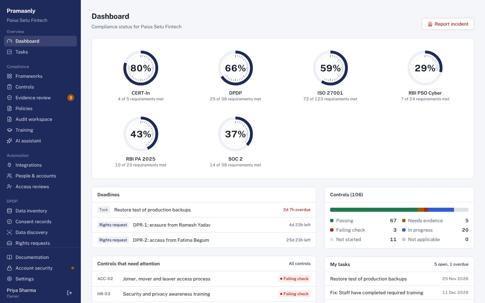
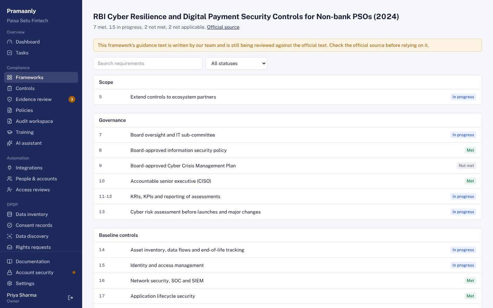
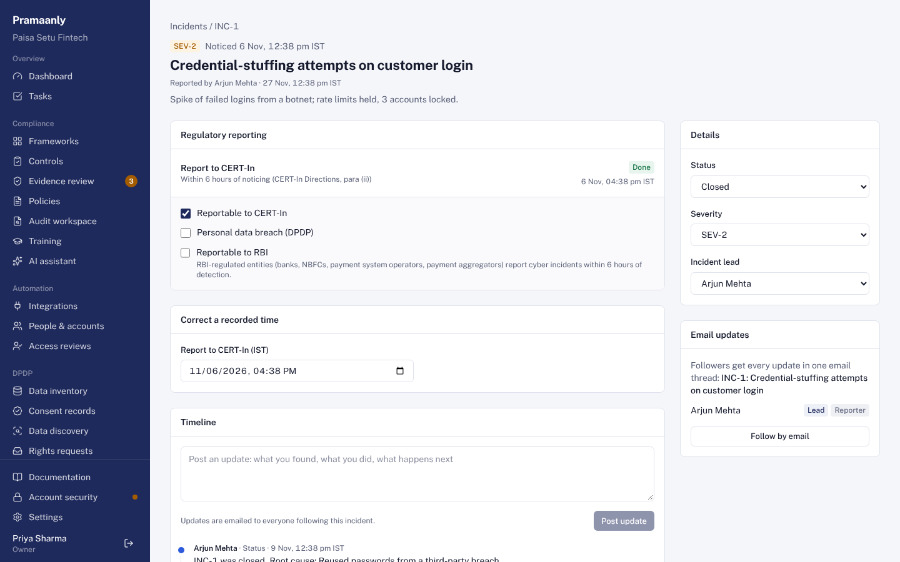
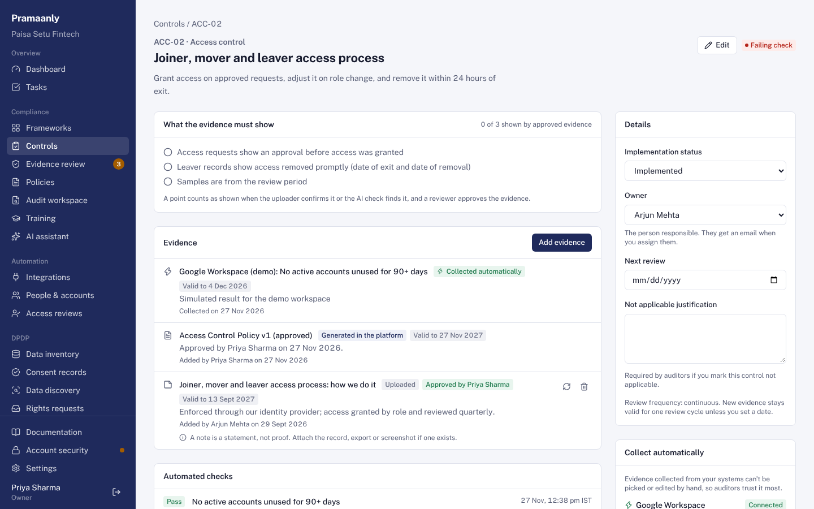
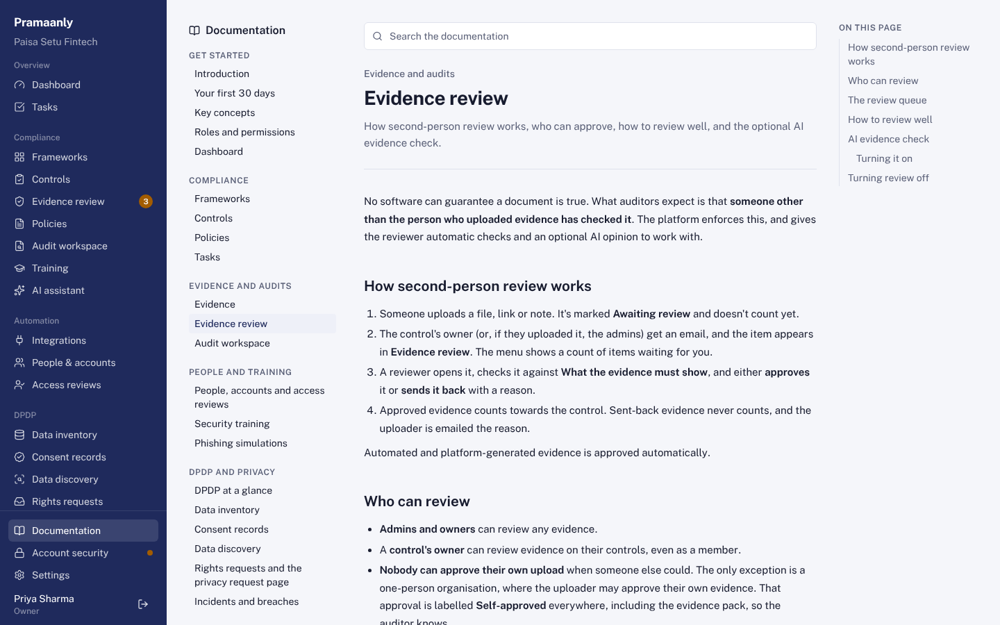

# Pramaanly

**Open-source compliance automation, built India-first.** One set of controls mapped to India's DPDP Act, CERT-In and the RBI, SEBI, IRDAI and IFSCA cyber rules, plus ISO 27001, SOC 2, NIST CSF, PCI DSS, GDPR and more. Pramaanly collects and checks the evidence, tracks policies, risks, vendors, training and incidents, and gets you audit-ready.

[](LICENSE)
[](https://github.com/bhatisunil2706/pramaanly/actions/workflows/ci.yml)
[](https://bhatisunil2706.github.io/pramaanly/)

**[▶ Try the live demo](https://bhatisunil2706.github.io/pramaanly/)**: the real interface with sample data for a fictional fintech. No sign-up; read-only.



*Pramaanly* comes from **pramaan** (प्रमाण), "proof": compliance you can prove, with evidence an auditor can trust.

## Why Pramaanly

- **Built for Indian regulation.** DPDP consent records, rights requests and breach clocks; the CERT-In 6-hour rule; the RBI Cybersecurity Directions of July 2026 (tiered by NBFC layer) and RBI payment, lending and outsourcing rules; SEBI CSCRF, IRDAI and IFSCA. Global frameworks use the same controls, so work done once counts everywhere.
- **Evidence you can trust.** Uploaded evidence counts only after a second person approves it against written acceptance criteria. Files are fingerprinted (SHA-256) and verified on every download, automatic checks flag reused, outdated or template evidence, and auditors test reproducible random samples.
- **Secure by design.** PostgreSQL row-level security between companies, per-company encrypted evidence, a hash-chained audit log, MFA and SSO. See [SECURITY.md](SECURITY.md) and [docs/security.md](docs/security.md).
- **Self-hosted.** Your compliance data stays on your own infrastructure. One `docker compose` command to start.

## Features

| Area | What you get |
| --- | --- |
| Frameworks | 18 frameworks, 771 requirements and 124 shared controls, every requirement mapped and validated in tests. Conditional requirements switch on from a short company profile. [Full list below](#frameworks). |
| Controls and evidence | Owners, review cycles, files, links and notes as evidence, second-person review, acceptance criteria per control, automatic checks, optional AI evidence check, health and readiness per framework |
| Integrations | 25 integrations with 71 automated checks (AWS, Azure, Google Cloud, Google Workspace, Microsoft 365, Okta, GitHub, GitLab, CrowdStrike, Intune, Snyk, Keka and more), plus an evidence API for anything else. All read-only except Jira issue creation. |
| Policies | Upload Word, PDF or Markdown, paste from Google Docs or Word, or write in the editor; templates, versions, approval and staff acknowledgement |
| Risk register | Likelihood x impact heat map, treatment plans, linked controls, two-way Jira sync |
| Incidents | Report from the dashboard; CERT-In, DPDP Board and financial-regulator clocks (RBI, SEBI, IRDAI, IFSCA); timeline; one email thread per incident |
| DPDP operations | Data inventory, consent records with an API and withdrawal feed, rights requests with a public request page and SLA tracking, personal data discovery (databases and S3, with a self-hosted scanner) |
| Vendors | Risk tiers, certificates and DPAs, a library of security questionnaires (full, lite, baseline, plus DPDP, GDPR, AI and PCI add-ons) sent by secure link and scored automatically |
| People and training | HR roster matched to accounts, leaver checks, access reviews, 12 security awareness courses, phishing simulations, certificates |
| Audits | Auditor role with time-limited access, evidence requests, Statement of Applicability, evidence pack with a SHA-256 manifest, sampling |
| AI assistant (opt-in) | Policy drafts, gap remediation plans and questionnaire answers from your own policies (Claude API) |
| Documentation | 36 in-app articles with search and a Help button on every page |

<table>
  <tr>
    <td></td>
    <td></td>
  </tr>
  <tr>
    <td></td>
    <td></td>
  </tr>
</table>

## Frameworks

| Region | Frameworks |
| --- | --- |
| India | DPDP Act 2023 and DPDP Rules 2025; CERT-In Directions (April 2022) |
| Indian financial regulators | RBI Cybersecurity, Technology Risk, Resilience and Assurance Directions (2026); RBI Digital Payment Security Controls (2026); RBI cyber resilience for non-bank payment system operators (2024); RBI Payment Aggregators (2025); RBI Digital Lending (2025); RBI Outsourcing of IT Services (2023); SEBI CSCRF (2024); IRDAI Information and Cyber Security Guidelines (2026); IFSCA Cyber Security Guidelines (2025) |
| Global | ISO/IEC 27001:2022 (all clauses and 93 Annex A controls); SOC 2 (all five categories); NIST CSF 2.0; PCI DSS v4.0.1; ISO/IEC 42001 |
| Other regions | GDPR; HIPAA Security and Breach Notification Rules |

Guidance text is written by the project, not copied from the standards. ISO, AICPA and PCI SSC text is intentionally not reproduced. Content marked **draft** in the app is still being reviewed against the official sources: please check the source before relying on it, and see [Project status](#project-status).

## Quick start

Requirements: Docker with Docker Compose.

```bash
git clone https://github.com/bhatisunil2706/pramaanly.git
cd pramaanly
cp .env.example .env
./start.sh
```

`start.sh` builds the images, upgrades the database, starts everything, loads three demo companies and opens http://localhost:3000. Sign in as `priya@paisasetu.example` with the password `Demo-Pramaanly-2026!`.

Prefer plain Compose? `docker compose up --build`, then `docker compose run --rm migrate python -m app.cli seed-demo` for the demo data.

### Demo companies

| Company | Owner | Admin | Member | Auditor |
| --- | --- | --- | --- | --- |
| Paisa Setu Fintech (DPDP, CERT-In, ISO 27001, SOC 2, RBI PSO and PA; about 70% ready) | priya@paisasetu.example | arjun@paisasetu.example | neha@paisasetu.example | kavya@paisasetu.example |
| AarogyaLink Health (DPDP, ISO 27001; about 45%) | sameer@aarogyalink.example | lakshmi@aarogyalink.example | imran@aarogyalink.example | deepa@aarogyalink.example |
| KiranaKart Commerce (DPDP, CERT-In, SOC 2; just starting) | rajesh@kiranakart.example | sunita@kiranakart.example | amit@kiranakart.example | none |

All companies and people are fictional, and `.example` addresses never receive email. Set `DEMO_PASSWORD` to use your own password. The seed command refuses to run in production, and `python -m app.cli remove-demo` deletes the demo data.

## Production

```bash
cp .env.example .env      # set every value marked REQUIRED, ENVIRONMENT=production, PUBLIC_URL=https://<DOMAIN>
docker compose -f docker-compose.yml -f docker-compose.prod.yml up -d --build
```

This adds Caddy with automatic HTTPS, encrypted daily backups and read-only, non-root containers. The app refuses to start with default secrets, without secure cookies or Redis, or with a database role that can bypass row-level security. Back up `ENCRYPTION_KEY` separately from the database: without it, evidence can't be decrypted.

The in-app guide **Installing and running the platform** (Documentation → Administration) covers configuration, email, storage, backups, upgrades and admin commands.

## Architecture

```
Browser ── Next.js 16 (web) ──/api──> FastAPI (backend) ──> PostgreSQL 16 (row-level security)
                                           │                 Redis (rate limits, lockouts)
                                           └── worker: integration syncs, reminders, alerts, AI jobs
```

```
backend/
  app/content/        Frameworks, control library and mappings, policy templates, courses, questionnaires, docs
  app/api/routes/     REST API
  app/integrations/   Connectors with a shared interface
  app/services/       Compliance engine, evidence checks, reminders, encrypted storage, SSO, audit chain, AI
  app/rls.py          Row-level security policies and the restricted runtime role
  app/agent.py        Self-hosted personal data scanner
  alembic/            Database migrations
  tests/              Security, tenant isolation, roles, features, connectors
frontend/             Next.js app (dashboard, compliance, audits, DPDP, risk, vendors, settings, documentation)
deploy/               Caddyfile and backup script
demo/                 Builds the static live demo from a recording of the real app
docs/security.md      Threat model and security design
```

**How the engine works.** Global content in `backend/app/content` is loaded by `python -m app.cli load-content`, which fails if any requirement has no control. Turning on a framework creates the company's controls for every mapped, applicable requirement. A control is *passing* when it's implemented with current approved evidence and no failing automated check; a requirement is *met* when all its controls pass or don't apply.

## Development

Requirements: Python 3.12+, Node 22+, PostgreSQL 16, Redis (optional locally).

```bash
createdb app
cd backend
python -m venv .venv && source .venv/bin/activate
pip install -r requirements-dev.txt
export DATABASE_URL="postgresql+psycopg://$USER@localhost:5432/app"
alembic upgrade head && python -m app.cli load-content
uvicorn app.main:app --reload            # API docs at http://localhost:8000/api/docs
python -m app.worker                     # separate terminal: syncs, reminders, alerts, AI jobs

cd ../frontend && npm install && npm run dev
```

Locally the app connects as your own database user, which bypasses row-level security (startup logs a warning). To test with RLS on, run `RUNTIME_DB_PASSWORD=... python -m app.cli sync-runtime-role` and connect as `app_runtime`.

```bash
createdb app_test
cd backend
DATABASE_URL="postgresql+psycopg://$USER@localhost:5432/app_test" pytest -q   # runs as an RLS-restricted role
ruff check app tests && bandit -q -r app -c pyproject.toml && pip-audit -r requirements.txt
python -m app.cli check-content
cd ../frontend && npx tsc --noEmit && npm run build
```

- **Add a connector:** subclass `Connector` in `backend/app/integrations/`, declare `fields` and `tests` (each test lists the control codes it proves), implement `verify()` and `run()`, register it in `integrations/__init__.py`, and validate customer-supplied hosts with `guarded_base_url`. See `okta.py` and `tests/test_connectors.py`.
- **Add or edit a framework:** YAML files in `backend/app/content/frameworks/`, mapped to controls in `controls.yaml`. `check-content` validates the mapping.
- **Edit the documentation:** Markdown files in `backend/app/content/help/`. Links between articles are checked by `check-content` and the tests.
- **Update the live demo:** see [demo/README.md](demo/README.md).

## Contributing

Contributions are welcome: bug reports, fixes, connectors, translations, and especially **review of framework content by compliance and legal practitioners**. Read [CONTRIBUTING.md](CONTRIBUTING.md) to get started, and follow the [Code of Conduct](CODE_OF_CONDUCT.md).

Please write everything yourself or use material with a compatible licence: don't copy code, framework libraries or mappings from commercial or AGPL-licensed GRC products, and don't paste text from paid standards.

## Security

Please report vulnerabilities privately through [GitHub's private vulnerability reporting](https://github.com/bhatisunil2706/pramaanly/security/advisories/new), not in public issues. See [SECURITY.md](SECURITY.md).

## Project status

Pramaanly is early-stage (v0.5) and under active development. Before relying on it for a real audit:

1. **Content review.** Framework guidance, training courses and questionnaires are written by the project and many are marked draft. They need review by a privacy lawyer (DPDP, CERT-In, GDPR), banking and securities compliance specialists (RBI, SEBI, IRDAI, IFSCA paragraph mapping), a QSA (PCI DSS), a HIPAA specialist and an ISO 27001/42001 lead auditor.
2. **Real-tenant connector tests.** Connectors are built from official API documentation and tested with simulated responses; test them against your own accounts first.
3. **Independent penetration test** and an external review of [docs/security.md](docs/security.md).

Planned next: master keys in a KMS or HSM, DPDP Consent Manager integration once the interface is published, passkeys (WebAuthn) and SCIM provisioning.

Pramaanly helps you organise and evidence compliance work. It is not legal advice and does not by itself make an organisation compliant or certified.

## Licence

Copyright 2026 Sunil Bhati and contributors. Licensed under the [Apache License, Version 2.0](LICENSE). See [NOTICE](NOTICE).
